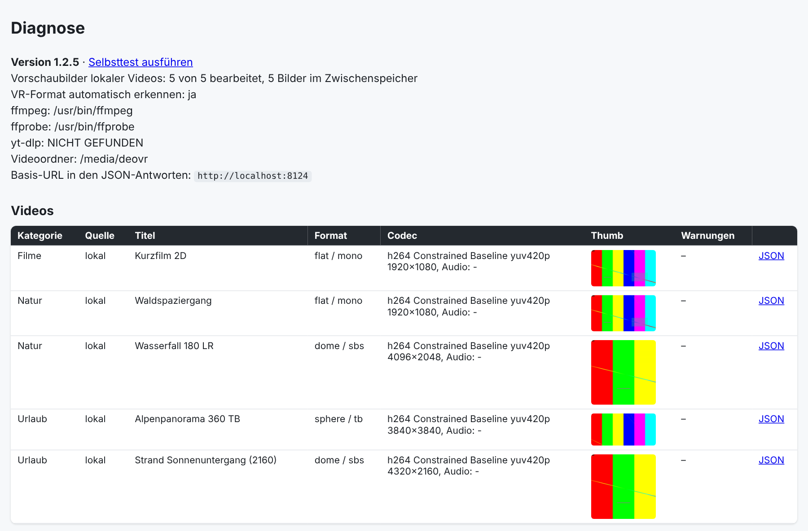

<div align="center">

# 🥽 PlayaVR Server

**Eigene VR-Videos und Webquellen für Playa und DeoVR – als Home-Assistant-Add-on für die Meta Quest**

[](https://my.home-assistant.io/redirect/supervisor_add_addon_repository/?repository_url=https%3A%2F%2Fgithub.com%2Fgier76%2Fplayavr-server-web)


*Self-hosted video library for [Playa](https://github.com/Playa-vr) and [DeoVR](https://deovr.com) (Meta Quest), served as a Home Assistant add-on: local files, web pages and yt-dlp sources, automatic VR projection detection, built-in diagnostics.*

</div>

---

## Was ist das?

DeoVR kann Bibliotheken von Servern laden, die ein bestimmtes JSON-Format sprechen ([offizielle Doku](https://deovr.com/app/doc)). Dieses Add-on ist so ein Server:

- 📁 **Lokale Videos**: Ordner in Home Assistant (`media/deovr`), Unterordner werden zu Kategorien
- 🌐 **Webseiten als Quelle**: Seiten mit direkten Videodateien (`type: web`)
- ▶️ **yt-dlp-Quellen**: alles, was [yt-dlp](https://github.com/yt-dlp/yt-dlp) versteht, inklusive Listenseiten; Streams werden erst beim Abspielen aufgelöst
- 🕶️ **VR-Format**: Erkennung über den Dateinamen (`180`, `360`, `LR`, `TB`, `FISHEYE` …) oder automatisch aus der Bildgröße
- 🖼️ **Vorschaubilder**: werden mit ffmpeg erzeugt (bei 3D nur ein Auge) und zwischengespeichert
- 🔎 **Diagnose**: `/debug` und `/selftest` zeigen, was DeoVR wirklich abruft
- 🌴 **Playa**: die gleiche Bibliothek ist auch ein Playa-Server (Playa API v2 unter `/api/playa/v2`) — die Playa-VR-App verbindet sich direkt mit der Server-Adresse

## Auch für die Playa-App

[Playa](https://github.com/Playa-vr/Playa-vr) ist ein VR-Video-Player für Meta Quest (Open-Source-Alternative zu DeoVR). Der Server spricht neben dem DeoVR-JSON auch die **Playa API v2**:

1. Playa starten, über das Zahnrad-Symbol **„Connect a server“**
2. Die Server-Adresse ohne Pfad eintragen (z. B. `http://192.168.1.21:8123/api/playa/deovr` beim HA-Add-on, oder `http://<deine-IP>:8000` direkt)

Die App fragt `/api/playa/v2/config`, `/categories` und `/videos` ab; Video-Listen, Kategorien (Unterordner), Vorschaubilder und VR-Formate (Projektion/Stereo aus der Erkennung) laufen wie bei DeoVR. Authentifizierung ist abgeschaltet, es werden keine Profil-Codes gebraucht. Gespielt wird über die bestehenden `/video/…`-Adressen (inkl. Range-Anfragen).

## Screenshot

Die Diagnoseseite (`/debug`, im Add-on über „Web-UI öffnen“) mit erkannten Formaten, Codecs und Vorschaubildern:



> Die Demo-Videos im Bild sind synthetische Testbilder.

## Installation

### Als Add-on-Repository (empfohlen)

1. In Home Assistant: **Einstellungen → Add-ons → Add-on-Store → ⋮ → Repositories**
2. `https://github.com/gier76/playavr-server-web` hinzufügen (oder oben auf den Badge klicken)
3. **PlayaVR Server** installieren und starten
4. Videos nach `media/deovr` legen (z. B. über die Samba-Freigabe)
5. In DeoVR auf der Quest öffnen: `http://<HA-IP>:8000/deovr`

> Nutze die **IP-Adresse**, nicht `homeassistant.local`. Namen mit `.local` löst der Player auf der Quest oft nicht auf.

### Als lokales Add-on

Den Ordner `playavr-server-web/` nach `/addons/playavr-server-web/` kopieren (`/addons/playavr-server-web/config.yaml` muss existieren), dann *Add-on-Store → ⋮ → Auf Updates prüfen* und unter „Lokale Add-ons“ installieren.

## Konfiguration

```yaml
video_dir: /media/deovr
update_ytdlp: true
auto_format: true          # VR-Format aus der Bildgröße erkennen
default_format: 180_LR     # optional: Vorgabe für lokale Videos ohne Hinweis im Namen
public_url: ""             # optional, z. B. http://192.168.1.50:8000
sources:
  - name: Seite mit direkten Videodateien
    type: web
    url: https://example.org/videos/
    format: 180_LR
  - name: Über yt-dlp
    type: ytdlp
    url: https://example.org/tag/xyz/
    format: 180_LR
    limit: 50
    max_height: 2160
```

Alle Optionen stehen in [`deovr/DOCS.md`](deovr/DOCS.md).

## VR-Format

| Namensteil | Bedeutung |
|---|---|
| `180` / `VR180` | 180°-Dome |
| `360` | 360°-Sphäre |
| `FISHEYE`, `FISHEYE190`, `MKX200` | Fisheye-Varianten |
| `LR` / `SBS` | Side-by-Side (3D) |
| `TB` / `OU` | Top-Bottom (3D) |

Fehlt jeder Hinweis, entscheidet die Bildgröße (ab 2880 Pixel Breite): etwa 2:1 → 180° SBS, etwa 1:1 → 360° TB. Das ist eine Faustregel; ein 2:1-Video kann auch 360° Mono sein. Für sichere Ergebnisse `default_format` bzw. `format` setzen.

## Vorschaubilder und HTTPS

DeoVR (getestet mit 15.9.3915) zeigt Vorschaubilder nur von gültigem HTTPS an; Bilder von `http://`-Adressen, auch im LAN, werden nicht geladen.

**Einfachster Weg, ohne Domain und Zertifikat:** `thumb_tunnel: true`. Das Add-on startet einen Cloudflare-Quick-Tunnel und liefert nur die Vorschaubilder darüber per HTTPS aus. Die Videos bleiben im LAN. Mit dieser Option sind die Vorschaubilder in DeoVR auf der Quest getestet und erscheinen. Datenschutz-Hinweis in der [Doku](deovr/DOCS.md) beachten: Die Bilder sind über eine zufällige, aber öffentliche Adresse erreichbar.

**Alternative mit eigener Domain:** zusätzlicher HTTPS-Server auf Port 8443 (Option `https_url`, Zertifikat aus `/ssl`). Einrichtung: [`deovr/DOCS.md`](deovr/DOCS.md).

## Diagnose

| Adresse | Zweck |
|---|---|
| `/debug` | Version, Quellen, Formate, Codecs, Vorschaubilder, was DeoVR abgerufen hat, zuletzt gelieferte JSON |
| `/selftest` | Textbericht, der ffmpeg, JSON und Quellen Schritt für Schritt prüft |
| `/refresh` | Webquellen sofort neu einlesen |

## Bekannte Einschränkungen

- Keine Anmeldung: nur im Heimnetz betreiben, Port **nicht** ins Internet weiterleiten.
- Nicht unterstützt: reine HLS/DASH-Streams, Videos hinter Anmeldung, DRM.
- Die DeoVR-Doku verlangt HTTPS „für alle Android-Versionen“. Der Server spricht nur HTTP, in der Praxis läuft das Abspielen im Heimnetz damit.
- Das Verhalten von Vorschaubildern und Projektionsmenü in DeoVR hängt von der DeoVR-Version ab. Hilfe bei Problemen liefert `/debug`; bitte beim Melden eines Issues die Tabelle „Was DeoVR abgerufen hat“ beilegen.

## Rechtliches

Bitte nur Inhalte einbinden, die du nutzen darfst, und die Nutzungsbedingungen der jeweiligen Seiten beachten. Dieses Projekt steht in keiner Verbindung zu DeoVR, Meta oder Home Assistant.

## Entwicklung

```bash
# Server ohne Home Assistant starten
pip install flask
VIDEO_DIR=./videos CACHE_DIR=./cache PORT=8000 SOURCES_JSON='[]' python3 deovr/server.py
```

Voraussetzungen für volle Funktion: `ffmpeg`/`ffprobe` im Pfad, optional `yt-dlp`.

## Lizenz

[MIT](LICENSE)
